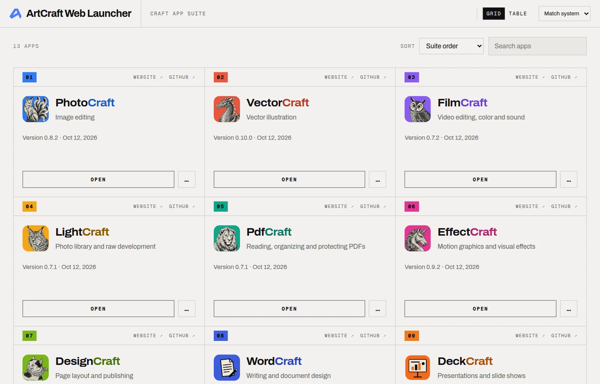

# ArtCraft Web Launcher

Run the [Craft browser apps](https://getartcraft.com) on your own server. One container serves a
launcher and every app of the suite, installs their official releases from GitHub and keeps them
up to date.



The apps run in the browser. The server only serves their files: it stores no documents, and the
apps cannot open folders on the server.

## Features

- **The whole suite**: PhotoCraft, VectorCraft, FilmCraft, LightCraft, PdfCraft, EffectCraft,
  DesignCraft, WordCraft, DeckCraft, GridCraft, CADCraft, SoundCraft, FigCraft and Craft
  Anything, plus the community app SolidCraft from ArtCraft Launcher's catalogue. Apps released
  later are discovered from the ArtCraft release feed, whoever publishes them, and installed
  automatically.
- **Launcher** at `/`, styled after ArtCraft Launcher: grid and table views, app pages with
  screenshots, and the launcher's translations.
- **Verified updates**: every release is checked against its checksum and validated before it
  goes live, at once or when the app is idle. Releases can be pinned and rolled back.
- **Stable URLs**: `/photocraft/` serves the active release; `/photocraft/<version>/` serves a
  retained one.
- **Optional sign-in** with local accounts, OpenID Connect, HTTP Basic or a trusted reverse
  proxy, and `user` and `admin` roles.
- **Administration** at `/admin/`: check, update, pin, roll back, enable and disable apps, and
  manage accounts.
- **Small and locked down**: one static binary in a distroless image for `linux/amd64` and
  `linux/arm64`, running as a non-root user on a read-only filesystem. No Docker socket,
  database or GPU needed.

## Quick start

With Docker and Compose v2:

```sh
git clone https://github.com/AurelioB/artcraft-web-launcher.git
cd artcraft-web-launcher
cp .env.example .env    # user and group IDs, host directories, port
```

Create the directories named in `.env`, owned by its `RUN_UID` and `RUN_GID` (the example values
are shown), add the configuration and start:

```sh
sudo install -d -o 1000 -g 10000 -m 2775 /srv/craft-apps/{config,data,state,cache,work}
sudo install -m 0640 -o 1000 -g 10000 config.example.toml /srv/craft-apps/config/config.toml
docker compose pull && docker compose up -d
```

Open `http://<server>:8080/`. On first start the apps download in the background and appear as
they finish; `docker compose logs -f host` shows progress.

Over plain HTTP from another machine, browsers turn off WebGPU, file storage and the clipboard for
the apps. Put an HTTPS reverse proxy in front for regular use; see
[HTTPS and the reverse proxy](docs/install.md#https-and-the-reverse-proxy).

Other ways to run it: [Unraid](docs/install.md#unraid), [`docker run`](docs/install.md#docker-run)
and [a standalone binary](docs/install.md#without-docker).

## Configuration

Settings live in `config.toml` in the config directory. Every setting is optional;
[`config.example.toml`](config.example.toml) lists them all with their defaults. Restart after a
change (`docker compose restart host`).

| Section | Controls |
| --- | --- |
| `[updater]` | Check interval, GitHub token, immediate or idle activation |
| `[auth]` | Sign-in methods; whether the apps need sign-in |
| `[admin]` | `/admin/` on or off, optional separate host name |
| `[retention]` | Releases kept per app, archive cache size |
| `[discovery]` | Finding newly released apps |
| `[apps.<id>]` | Per app: enable, pin, channel, URL path, own origin; additional apps |

Without a token, update checks share GitHub's limit of 60 API requests per hour per IP address:
scheduled checks then use at most half of it and pause when 10 or fewer are left. A read-only
token raises the limit to 5000; see [GitHub token](docs/install.md#github-token).

The full list is in the [configuration reference](docs/configuration.md).

## Sign-in and administration

`/admin/` is off by default. To turn it on with local accounts, set these in `config.toml`:

```toml
[auth]
methods = ["local"]

[admin]
enabled = true
```

Then restart and add an administrator:

```sh
docker compose restart host
docker compose exec -T host craft-host user add alice --role admin <<<'a long passphrase'
```

With `[auth] apps = "signed-in"`, the launcher and apps also require an account. OpenID Connect,
reverse-proxy sign-in and roles are covered in [sign-in and administration](docs/admin.md).

## Updates

Apps update themselves: each app is checked hourly, and the release feed is read daily for new
apps. To update the launcher itself:

```sh
docker compose pull && docker compose up -d
```

Images are published as `ghcr.io/aureliob/artcraft-web-launcher` with the tags `latest`, `X.Y`
(newest patch of a minor version, e.g. `0.4`) and `X.Y.Z`; `edge` follows the main branch. Set
`IMAGE` in `.env` to pin one. Releases, state and accounts are kept across updates; see
[operations](docs/operations.md) for backups.

## Command line

The binary is `craft-host`. With Compose, run it as `docker compose exec host craft-host <command>`.

| Command | Purpose |
| --- | --- |
| `status` | Installed, active and latest versions, pins and errors |
| `doctor` | Check configuration, permissions, disk space and connectivity |
| `check [APP]`, `update [APP]` | Look for, or install, the newest release |
| `pin APP VERSION`, `unpin APP` | Hold an app on a release, or follow releases again |
| `rollback APP [VERSION]` | Go back to a retained release |
| `user …` | Manage accounts (passwords are read from standard input) |

`craft-host --help` lists every command.

## Documentation

- [Installation](docs/install.md): directories, Unraid, `docker run`, standalone binary, HTTPS
- [Configuration reference](docs/configuration.md)
- [Sign-in and administration](docs/admin.md)
- [Users, groups and permissions](docs/permissions.md)
- [Operations](docs/operations.md): updates, retention, backup and recovery
- [Apps and browser storage](docs/apps.md)
- [Architecture](docs/architecture.md)
- [Verification record](docs/verification.md)
- [Changelog](CHANGELOG.md)

## Development

The Rust sources are in [`host/`](host):

```sh
cd host
cargo test                                          # unit, lifecycle and HTTP tests
cargo test --test compose -- --ignored --nocapture  # Docker Compose end-to-end test
```

`docker compose build` in the repository root builds the image locally.
